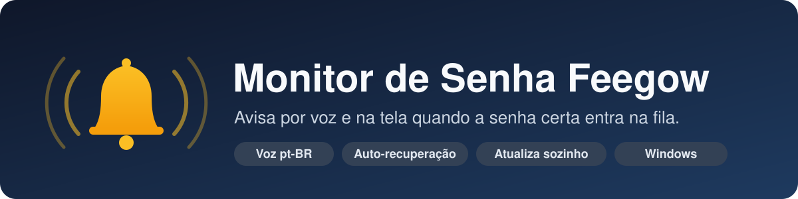
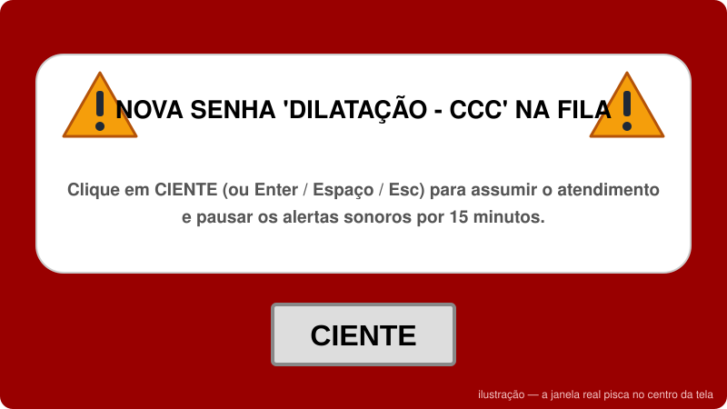
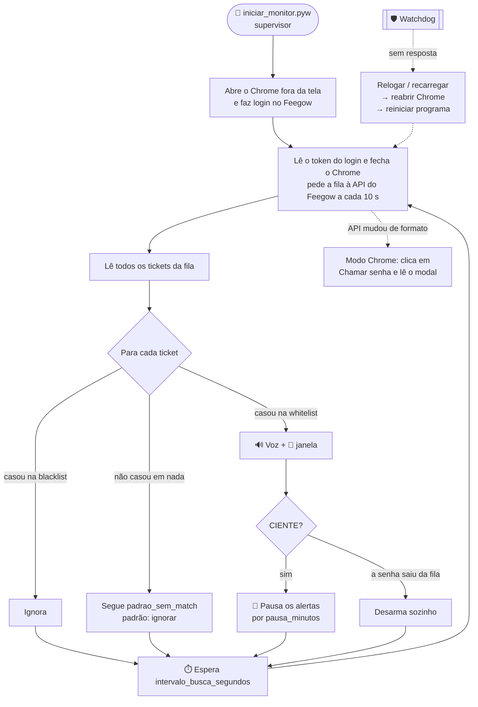

<p align="center">
  
</p>

<h1 align="center">🔔 Monitor de Senha Feegow</h1>

<p align="center">
  <b>Ninguém mais perde a senha de dilatação.</b><br>
  O monitor fica de olho na Lista de Espera do Feegow e <b>fala em voz alta</b> (e, se você quiser, pisca uma janela vermelha) assim que entra na fila a senha que importa.
</p>

<p align="center">
  <a href="https://github.com/Nicker2/script-monitoramento/releases/latest"></a>
  
  
  
  <a href="https://github.com/Nicker2/script-monitoramento/actions/workflows/ci.yml"></a>
  <a href="LICENSE"></a>
  
</p>

<p align="center">
  <a href="https://github.com/Nicker2/script-monitoramento/releases/latest"><b>⬇️ Baixar a versão Python (ZIP)</b></a>
  &nbsp;·&nbsp;
  <a href="#-instalação">📦 Instalar</a>
  &nbsp;·&nbsp;
  <a href="#-configuração">⚙️ Configurar</a>
  &nbsp;·&nbsp;
  <a href="#-solução-de-problemas">🩹 Problemas</a>
</p>

---

## 📑 Sumário

- [✨ O que faz](#-o-que-faz)
- [🧭 Como funciona](#-como-funciona)
- [📋 Requisitos](#-requisitos)
- [📦 Instalação](#-instalação)
- [🚀 Como usar no dia a dia](#-como-usar-no-dia-a-dia)
- [🔧 Configuração](#-configuração)
- [💻 Exemplos do que você vê](#-exemplos-do-que-você-vê)
- [🩹 Solução de problemas](#-solução-de-problemas)
- [❓ Perguntas frequentes](#-perguntas-frequentes)
- [🧰 Para quem mantém](#-para-quem-mantém)
- [🤝 Contribuição](#-contribuição)
- [📄 Licença e autor](#-licença-e-autor)

---

## ✨ O que faz

O script abre o Feegow num Chrome controlado pelo Selenium, entra na **Lista de Espera**, clica em **"Chamar senha"** de tempos em tempos e lê os tickets que aparecem no modal. Se algum deles for uma senha que você marcou para **alertar**, ele avisa.

| | Recurso | Em poucas palavras |
| :---: | :--- | :--- |
| 🔊 | **Alerta por voz** | Fala em português na saída de som padrão do Windows, com **fala própria por filtro** (Dilatação: "Atenção! Senha de dilatação"; Lentes: "Nova Senha"; MC: sem voz). Senha fora dos filtros: "Atenção! Senha ...". Sem internet, usa a voz do Windows; sem nenhuma voz, toca um bipe. |
| 🚨 | **Janela piscante** | Janela vermelha no centro da tela com o botão **CIENTE** (Enter, Espaço ou Esc também servem). Pode ser ligada ou desligada. |
| 🎯 | **Filtros por lista** | `whitelist` = alertar, `blacklist` = ignorar (a whitelist vence). Ignora acentos e maiúsculas. Avalia **todos** os tickets do modal, não só o primeiro. |
| ⚡ | **Padrões prontos** | Um clique troca o filtro: 🩺 Dilatação, 👓 Lentes, 🔔 MC, 🎫 R2. O filtro anterior vai para `filtros.backup.json`. |
| 🤫 | **CIENTE silencia** | Ao clicar em CIENTE, os alertas param por `pausa_minutos` (padrão 15). Se a senha sair da fila, o alarme se desarma sozinho. |
| 👻 | **Chrome escondido** | O navegador roda fora da tela e o programa vive no **ícone da bandeja**, cuja cor mostra o estado (🟢 🟠 ⚪ 🔴). |
| 🛡️ | **Auto-recuperação** | Um watchdog refaz o login, recarrega a página, reabre o Chrome ou reinicia o programa quando algo trava. Um supervisor relança o monitor se ele cair. Parou ou deu erro? Ícone vermelho, **balão com setinha acima da bandeja** e voz avisam (2.3.5). |
| 🔄 | **Atualização automática** | Consulta o `versao.json` assinado (Ed25519) deste repositório, instala num momento seguro e volta para a versão anterior se a nova falhar. |
| 🔐 | **Senha protegida** | A senha do Feegow fica cifrada pelo Windows (DPAPI) e o e-mail aparece mascarado no log. |
| 🧩 | **Instalação simples** | Um ZIP com tudo na [release](https://github.com/Nicker2/script-monitoramento/releases/latest): Python 3.12, extrair, duplo clique. As bibliotecas e o ChromeDriver certo são instalados sozinhos. (O `.exe` foi descontinuado.) |
| 🧹 | **Limpeza de disco** | `LIMPAR_LIXO.py` acha e apaga o lixo que o Chrome/ChromeDriver deixam no PC. |

<p align="center">
  <br>
  <sub>Ilustração da janela de alarme (desenho, sem dados reais).</sub>
</p>

---

## 🧭 Como funciona



**Modo requisição (2.3.0, padrão):** depois do login, o monitor pega a fila direto da API do Feegow (uma requisição a cada `intervalo_requisicao_seg`, padrão 10 s) com o Chrome **fechado**, o que é mais leve e não depende da página. O Chrome volta a abrir só para relogar ou quando você mostra o painel pela bandeja. Se a API do Feegow mudar, o monitor volta sozinho para o modo antigo (clique no *Chamar senha*). Para usar sempre o modo antigo, ponha `"modo_busca": "chrome"` no `filtros.json`. Desde a 2.3.4 a sessão (o token) fica guardada, cifrada para o seu usuário do Windows, em `%LOCALAPPDATA%\MonitorFeegow\sessao.dat`: ao abrir ou reiniciar, se ela ainda valer, o monitor nem abre o Chrome nem faz login (nada de "sessão dupla" derrubando outra máquina); se não valer, apaga e loga de novo. Detalhes em [AVANCADO.md](docs/AVANCADO.md#modo-requisição-230).

A comparação **ignora acentos, maiúsculas e pontuação**: `PRIORITARIA` no `filtros.json` casa com `PRIORITÁRIA` na tela, e `DILATAÇÃO-CCC` casa com `dilatacao ccc`.

---

## 📋 Requisitos

| | Item | Observação |
| :---: | :--- | :--- |
| 🪟 | **Windows 10 ou 11 (64 bits)** | A bandeja, a senha protegida (DPAPI) e o início automático são do Windows. |
| 🌐 | **Google Chrome** instalado | O ChromeDriver compatível é baixado sozinho para `%LOCALAPPDATA%\MonitorFeegow\drivers`. |
| 🔑 | **Usuário do Feegow** com acesso à Lista de Espera | Prefira um usuário só para o monitor: o mesmo usuário em dois PCs derruba a sessão do outro. |
| 🐍 | **Python 3.12** (marque *Add to PATH* ao instalar) | O CI testa no Python 3.12. As bibliotecas estão no [`requirements.txt`](requirements.txt). |
| 📶 | **Internet** | Para o Feegow e para gerar a voz (com cache permanente; sem internet usa a voz do Windows). |

Bibliotecas: `selenium`, `webdriver-manager`, `gTTS`, `pygame`, `pystray`, `Pillow`, `psutil`. O script confere e instala as que faltarem antes de abrir.

---

## 📦 Instalação

### Opção A: ZIP pronto em Python (recomendado para os PCs da recepção)

1. Instale o **Python 3.12** (<https://www.python.org/downloads/windows/>). Na primeira tela do instalador marque **"Add python.exe to PATH"**.
2. Baixe o **`MonitorSenhas-<versão>-python.zip`** da **[última versão](https://github.com/Nicker2/script-monitoramento/releases/latest)** ([todas as versões](https://github.com/Nicker2/script-monitoramento/releases)).
3. Extraia numa pasta fixa, por exemplo `C:\MonitorSenhas\` (não rode de dentro do ZIP nem da pasta Downloads).
4. Dê duplo clique em **`iniciar_monitor.pyw`**. Na primeira vez ele instala as bibliotecas que faltarem (pode levar alguns minutos), cria `filtros.json`/`credenciais.json` e **pede o login**. Salve o login: o monitoramento começa sozinho.
5. Para ligar junto com o Windows, rode **`instalar_inicio_automatico.bat`** (veja abaixo).

```
📁 C:\MonitorSenhas
   ├── SCRIPT_EXPLICA.py
   ├── iniciar_monitor.pyw        ← é este que você abre
   ├── filtros.json
   ├── credenciais.exemplo.json   ← só modelo; o credenciais.json é criado no primeiro uso (nunca compartilhe)
   ├── requirements.txt
   ├── instalar_inicio_automatico.bat / remover_inicio_automatico.bat
   ├── ferramentas\inicio_automatico.ps1
   └── LEIA-ME.txt
```

Depois disso as atualizações são **automáticas** (veja [Atualização automática](docs/AVANCADO.md#atualização-automática)); não precisa baixar o ZIP de novo.

> [!WARNING]
> **O `MonitorFeegow.exe` foi descontinuado** (parou na 2.2.0, as releases com `.exe` foram retiradas e ele não recebe mais atualizações). PC que ainda usa o `.exe`: encerre-o pela bandeja (**Encerrar Sistema**), rode `remover_inicio_automatico.bat` da pasta antiga, apague o `.exe` e **reinstale pela Opção A**. Pode copiar o `filtros.json` e o `credenciais.json` da pasta antiga para a nova.

### Opção B: clone do git (desenvolvimento)

```bash
git clone https://github.com/Nicker2/script-monitoramento.git
cd script-monitoramento
pip install -r requirements.txt   # opcional: o script instala o que faltar
```

Depois, dê duplo clique em **`iniciar_monitor.pyw`** (ou rode `python SCRIPT_EXPLICA.py` para testar com console). Na primeira execução ele cria os arquivos de configuração e abre a janela de login. Pastas que são clone do git não se atualizam sozinhas (use `git pull`).

> [!TIP]
> PC sem internet ou com download bloqueado? Baixe o `chromedriver-win64.zip` da mesma versão do seu Chrome em <https://googlechromelabs.github.io/chrome-for-testing/> e coloque o `chromedriver.exe` na pasta do script.

### Ligar junto com o Windows

Duplo clique em **`instalar_inicio_automatico.bat`** (cria um atalho na pasta Inicializar, sem precisar de administrador). Para desfazer: `remover_inicio_automatico.bat`.

---

## 🚀 Como usar no dia a dia

| Situação | O que fazer |
| :--- | :--- |
| Abrir o monitor (com Python) | Duplo clique em **`iniciar_monitor.pyw`**. Não abre janela: o ícone aparece na bandeja. |
| Ver o painel e o navegador | Clique no ícone da bandeja (perto do relógio). |
| Reiniciar | Botão direito no ícone → **Reiniciar monitor**. |
| Fechar de vez | Botão direito no ícone → **Encerrar Sistema** (fecha o Chrome e o supervisor). |
| Ver erros na tela | `DEBUG_EXECUTAR_EXPLICA.BAT` ou `python iniciar_monitor.pyw --console`. |

**Cor do ícone da bandeja:** 🟢 conectado · 🟠 recuperando · ⚪ sem internet · 🔴 falhas repetidas. Passe o mouse para ver o estado (aparece **"Sem áudio"** quando não há como falar).

> [!IMPORTANT]
> Use sempre o `iniciar_monitor.pyw`. Ele é o supervisor: relança o monitor se cair, aplica os reinícios do watchdog e da atualização e não deixa abrir duas cópias. Os arquivos `executar_iniciar_explica.BAT`, `iniciar_explica.py` e `executar_invisivel_explica.py` ficaram só para não quebrar atalhos antigos.

---

## 🔧 Configuração

O jeito mais fácil é pelo painel: ícone da bandeja → Mostrar → **⚙️ Configurações**.

| Aba | O que tem |
| :--- | :--- |
| **Senhas** | Listas ✅ **ALERTAR** (whitelist) e 🚫 **IGNORAR** (blacklist) e os botões ⚡ **Padrões prontos**. |
| **Login** | Usuário, senha (com "mostrar senha") e rota (`auto` / `sso` / `legado`). Trocar o login reabre o navegador sozinho. |
| **Alertas** | Janela e voz liga/desliga, pausa, intervalo, saída de som e anti-repetição. |
| **Falas** | Para cada filtro (Dilatação, Lentes, Marcação MC, R2): senhas/termos, o texto da **Fala**, a caixa **Falar em voz alta** e **▶ Testar**. Fala vazia = lê a senha da tela. |
| **Sistema** | Versão, atualização automática, watchdog, limites do Chrome, heartbeat remoto e os botões **Procurar atualização agora**, **Abrir pasta de logs** e **📋 Copiar diagnóstico** (sem segredos, e-mails mascarados). |

O **💾 Salvar** grava em `filtros.json` e `credenciais.json`, e vale na hora. Também dá para editar o `filtros.json` à mão: ao salvar o arquivo, o monitor recarrega sozinho.

### Principais opções do `filtros.json`

| Chave | Padrão | O que faz |
| :--- | :--- | :--- |
| `whitelist` | 7 senhas de dilatação | Senhas que **devem alertar** (vencem a blacklist). |
| `blacklist` | consultas, exames, recepções… | Senhas que devem ser **ignoradas**. |
| `padrao_sem_match` | `"ignorar"` | O que fazer com senha fora das duas listas (`alertar` ou `ignorar`). |
| `comparacao` | `"contem"` | `contem` ou `exata` (use `exata` para `MC` não pegar `DILATAÇÃO - CMC`). |
| `termos_gatilho` | lista | Textos usados para achar os botões no modal. Atualizado sozinho quando você adiciona senhas pela tela. |
| `alerta_voz` | `true` | Liga/desliga a fala (geral). |
| `falas_filtros` | Dilatação, Lentes, MC, R2 | Fala e voz de cada filtro: `{"termos": [...], "comparacao": "contem", "fala": "...", "voz": true}`. Padrões: Dilatação = "Atenção! Senha de dilatação", Lentes = "Nova Senha", MC = `"voz": false`, R2 = lê a senha. Ver [docs/AVANCADO.md](docs/AVANCADO.md#fala-por-filtro-220). |
| `alerta_tela` | `false` (no `filtros.json` do repositório) | Liga/desliga a janela vermelha piscante. |
| `pausa_minutos` | `15` | Silêncio depois do CIENTE. |
| `intervalo_busca_segundos` | `10` | Intervalo entre as verificações. |
| `alarme_max_segundos` | `120` | Tempo máximo tocando sem ninguém clicar (`0` = sem limite). |
| `intervalo_repeticao_segundos` | `15` | De quanto em quanto tempo a fala se repete durante o alarme. |
| `volume_alarme` | `100` | Volume da fala (0 a 100). |
| `saida_audio` | `"padrao"` | `padrao` (saída do Windows), `todos` ou o nome exato de um dispositivo. |
| `anti_repeticao_segundos` | `60` | Não anuncia a mesma senha de novo dentro dessa janela (`0` desliga). |
| `horario_funcionamento` | desligado | Ex.: `{"ativo": true, "inicio": "06:00", "fim": "20:00", "dias": ["seg","ter","qua","qui","sex","sab"]}`. Fora do horário o Chrome fica fechado. |
| `auto_atualizar` | `true` | Liga/desliga a atualização automática. |
| `max_relogins_por_hora` | `3` | Passou disso, para de relogar por 60 min (outro PC com o mesmo usuário?). |
| `reiniciar_a_cada_min` | `60` | Reinicia o programa sozinho a cada N minutos (adia durante alerta ou pausa do CIENTE). `0` desliga. |
| `alerta_falha_min` | `3` | Sem ciclo OK há N minutos = ícone vermelho, balão acima da bandeja e voz (2.3.5). `0` desliga. |
| `alerta_falha_repetir_min` | `10` | Enquanto durar a falha, repete o aviso no máximo a cada N minutos. |
| `alerta_falha_notificar` | `true` | Balões do monitor e do supervisor (falha, voltou, erro inesperado, relançamento). |
| `alerta_falha_voz` | `true` | Fala "Atenção: o monitor de senhas parou de funcionar" (só com `alerta_voz` ligado e nunca por cima de um alarme de senha). |

As opções de watchdog, Chrome (RAM, reinício diário, imagens), atualização e heartbeat remoto estão explicadas em [docs/AVANCADO.md](docs/AVANCADO.md).

### `credenciais.json`

Criado na primeira execução a partir do [`credenciais.exemplo.json`](credenciais.exemplo.json). Ele está no `.gitignore` e **nunca** deve ir para o GitHub. Depois do primeiro login, a senha passa a ficar em `senha_protegida` (cifrada para o usuário do Windows daquele PC).

```json
{
  "usuario": "seu.usuario@exemplo.com",
  "senha": "sua-senha",
  "rota_login": "auto"
}
```

---

## 💻 Exemplos do que você vê

**Topo do painel:**

```
● Conectado | último OK há 8s | v2.3.6
```

**Linhas do `logs/monitor.log`** (um `🔎` por ticket do modal; as listas aparecem normalizadas, sem acento nem hífen):

```
🔎 Senha 'AGENDAMENTOS' -> IGNORAR (blacklist: 'AGENDAMENTOS')
🔎 Senha 'DILATAÇÃO - CCC' -> ALERTAR (whitelist: 'DILATACAO CCC')
🔇 A senha saiu da tela — desarmando o alarme.
🔄 [N1] Página com problema (...) — recarregando (falha 1/4).
⚠️ ATENÇÃO: credenciais.json está com os dados de EXEMPLO. Preencha usuário e senha.
```

**Fala do alarme:** *"Atenção! Senha DILATAÇÃO - CCC."*

---

## 🩹 Solução de problemas

| Sintoma | O que fazer |
| :--- | :--- |
| 🔕 O alarme não toca | Veja no log as linhas `🔈 Áudio: ...` e se a bandeja mostra "Sem áudio". Confira a saída de som padrão do Windows. |
| 🔁 A voz sai duas ou três vezes | Confira `saida_audio` = `padrao` e se o Windows está com "Ouvir este dispositivo" ligado. |
| 🙈 Uma chamada real está sendo ignorada | Procure no log `🔎 Senha '...' -> IGNORAR (blacklist: '...')` e tire a palavra da blacklist (ou ponha a senha na whitelist). |
| 📢 Uma chamada de outro tipo dispara | Acrescente à `blacklist` ou use `"comparacao": "exata"`. |
| 🔑 O login não passa | Confira usuário e senha na aba **Login**. O log avisa se ainda estão os dados de exemplo. Senha errada para na hora, sem ficar tentando. |
| ⏱️ "Login demorou mais de 2 min: reiniciando o programa" | O login travou ou não terminou em 2 min (`login_timeout_seg`); o monitor reinicia sozinho. Se repetir sempre, confira a internet e o Feegow. |
| 👥 "Usuário já conectado em outra máquina" | Esperado se o mesmo usuário estiver em outro PC: o monitor reenvia o login a cada 1,5 s até assumir a sessão. Se ficar repetindo, há outro PC usando o mesmo usuário. |
| ⛔ Parou de relogar ("outro PC usando o mesmo usuário?") | Mais de 3 quedas de sessão numa hora. Ele espera 60 min; salvar o login na janela ⚙️ tenta de novo na hora. |
| 🔒 "Não consegui abrir a senha protegida" | O `credenciais.json` veio de outro PC ou usuário. Digite a senha de novo na aba **Login**. |
| 🌐 `Could not reach host` / `Unable to obtain driver for chrome` | O download do ChromeDriver foi bloqueado. Coloque o `chromedriver.exe` na pasta do script (ver [Instalação](#-instalação)). |
| 💥 `DevToolsActivePort file doesn't exist` | Um Chrome antigo travava o perfil. O monitor já encerra esses processos ao iniciar; se persistir, reinicie o PC. |
| ⏸️ Parou de avisar no meio do dia | Veja em `logs/monitor.log` as linhas `[N1]`/`[N2]`/`[N3]` com o motivo de cada recuperação. |
| ⬇️ Não atualizou sozinho | Pasta com `.git` não se atualiza (use `git pull`). Veja as linhas `Atualização:` no log. |
| ↩️ Atualizou e voltou para a versão anterior | A versão nova não conseguiu monitorar e foi revertida (veja `atualizacao_estado.json`, campo `motivo`). |
| 💾 Disco cheio | Rode `python LIMPAR_LIXO.py` para ver o relatório e `--limpar` para apagar. |

Para pedir ajuda, use **⚙️ Configurações → Sistema → 📋 Copiar diagnóstico** e cole o texto (ele não leva senha nem e-mail completo).

---

## ❓ Perguntas frequentes

<details>
<summary><b>Preciso deixar o Chrome aberto na tela?</b></summary>

Não. O Chrome do monitor roda fora da área visível e não aparece na barra de tarefas. Clique no ícone da bandeja para mostrá-lo.
</details>

<details>
<summary><b>Posso usar o mesmo usuário do Feegow em dois PCs com o monitor?</b></summary>

Não é recomendado: o Feegow permite uma sessão por usuário, então um PC derruba o outro. O monitor percebe isso e para de relogar depois de 3 quedas numa hora.
</details>

<details>
<summary><b>Quero alertar outra senha (ex.: lentes de contato). Preciso mexer no código?</b></summary>

Não. Use ⚡ **Padrões prontos → 👓 Lentes**, ou adicione a senha em ✅ ALERTAR na aba **Senhas**. Escreva como aparece na tela do Feegow.
</details>

<details>
<summary><b>Funciona sem internet?</b></summary>

O Feegow é on-line, então o monitoramento precisa de internet. Quando a conexão cai, o ícone fica ⚪ e o monitor espera ela voltar, sem reiniciar nada à toa.
</details>

<details>
<summary><b>A atualização automática é segura?</b></summary>

Ela só aceita um `versao.json` com assinatura Ed25519 válida e confere o sha256 do arquivo baixado. A versão nova fica "em teste" e, se não conseguir monitorar, o programa volta sozinho para a anterior. Detalhes em [docs/AVANCADO.md](docs/AVANCADO.md#atualização-automática).
</details>

<details>
<summary><b>Onde ficam os logs?</b></summary>

Na pasta `logs/` ao lado do programa: `monitor.log` (com rotação), `supervisor.log` e `status.json`. O botão **Abrir pasta de logs** (aba Sistema) leva direto até ela.
</details>

---

## 🧰 Para quem mantém

| Documento | Conteúdo |
| :--- | :--- |
| 📘 [docs/AVANCADO.md](docs/AVANCADO.md) | Watchdog, atualização automática, áudio, opções avançadas, DPAPI, assinatura e publicação de versões, heartbeat remoto, testes, compilação com Nuitka, limpeza de disco e lista de arquivos. |
| 📜 [docs/HISTORICO.md](docs/HISTORICO.md) | Histórico de alterações, versão por versão. |

Atalhos:

```bash
python -m pytest tests                              # testes (o CI roda no GitHub Actions a cada push)
compilar.bat                                        # gera dist\MonitorFeegow.exe (Nuitka; .exe descontinuado, não é mais publicado)
python ferramentas/gerar_versao.py --notas "..."    # monta e assina o versao.json
```

---

## 🤝 Contribuição

Contribuições são bem-vindas:

1. Faça um **fork** e crie uma branch (`git checkout -b minha-melhoria`).
2. Faça as alterações e rode `python -m pytest tests`.
3. Abra um **Pull Request** explicando o que mudou e por quê.

> [!CAUTION]
> Este repositório é **público**. Nunca envie `credenciais.json`, chaves (`*.pem`), logs ou qualquer dado de pacientes.

---

## 📄 Licença e autor

Distribuído sob a **Licença MIT**. Veja [LICENSE](LICENSE).

Criado por **Nicolas Bonza Cavalari Borges**.
